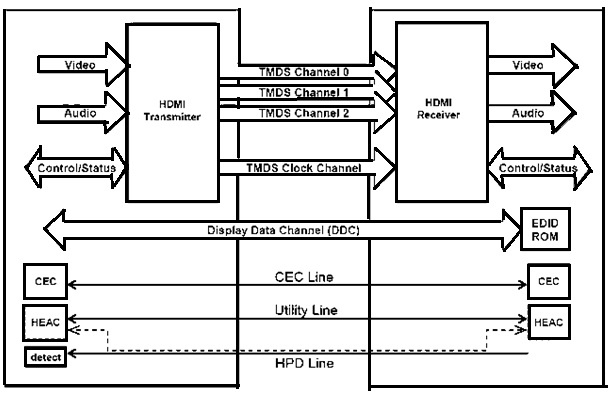
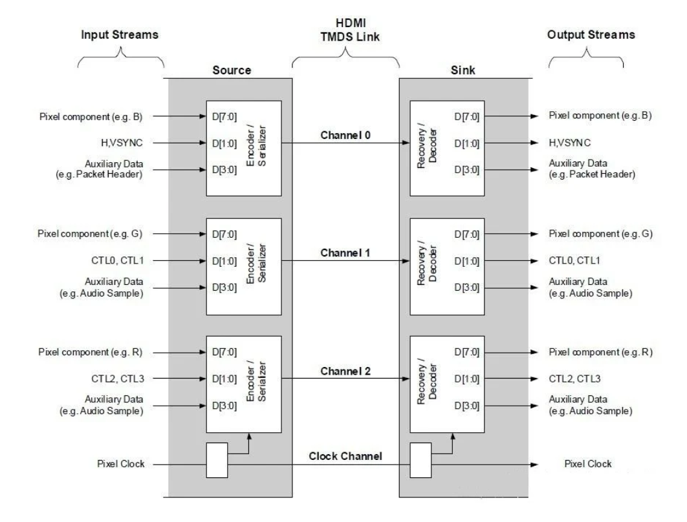
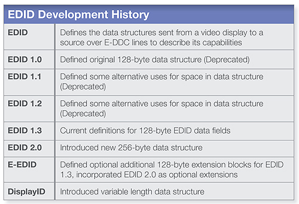
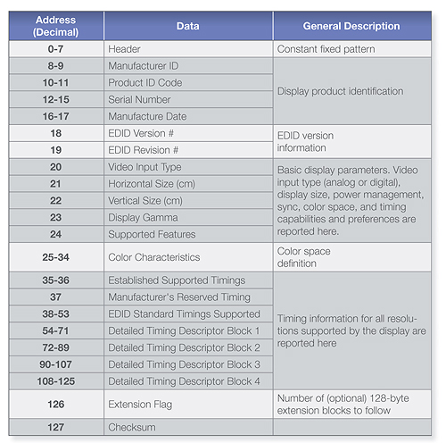
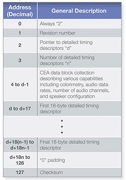
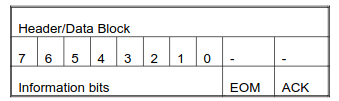
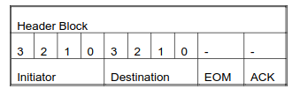
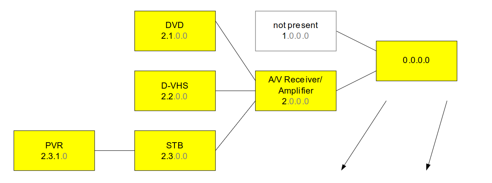
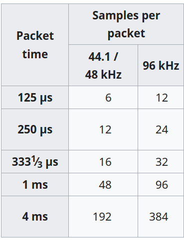

# HDMI
HDMI is a closed standard of multimedia transmission on short distances. This is an uncompressed high bandwidth transmission protocol. A single cable can support Video upto 8k, 10 channels of audio, CEC, HDR, and Ethernet.

## How ethernet works

As in figure the HDMI connection contains:
- 4 TMDS channels. 3 for data. 1 for TMDS Clock
- One DDC channel (display data channel) which provides I2C based communication for transferring EDID (Extended display identification data).
- One CEC (Consumer Electronic Control) line. More on them later.
- One HEAC (HDMI Ethernet and Audio-return channel). This pin is also multiplexed as HPD (Hot plug detect).

## TMDS Channel
This is a channel where the 0 to 1 transitions are minimized as possible using an algorithm which converts the 8bit data into 10. This is also a differential pair signaling. It is immune to the EMIs and other disturbances.

HDMI uses a serializer to make the parellel buses into serial data to be transmitted for each channel. Figure below indicates how.

## Time splittings
There are 3 time periods.
- Video data period
- Data island period
- Control period

### Video data period
In this period first 2 bits are the Video guard band and sends no data. After that, one horizontal line of video is transmitted. All three channnels are used and will send the red,green and blue channels or Y,Cb,Cr channels.
### Data island period
This time period is used to send Audio and auxiliary data. All three channels are used.
### Control period
This is the period which stand in between other periods. A 6 bit contol bit is transmitted as two bits per channel
- Channel 0:
    - Bit 0: HSYNC
    - Bit 1: VSYNC
- Channel 1:
    - Bit 2: CTL0
    - Bit 3: CTL1
- Channel 2:
    - Bit 4: CTL2
    - Bit 5: CTL3
HSYNC and VSYNC are used to sync the horizontal lines and frames. Just like in VGA fasion.
This CTL0 - CTL3 bits define what the next period coming is.

| CTL0 | CTL1 | CTL2 | CTL3 | period type |
|:--|:--|:--|:--|:--|
|1|0|0|0|Video Data period|
|1|0|1|0|Data island period|

# EDID
EDID (Extended Display Identification Data) is a type of data which describes the capablities and details of a video sink. This usually stored in a ROM and the source will read it using I2C via the Display Data channel. Currently E-EDID (Enhanced EDID) is in standard. Which is 256byte long by fasion but can be extended using various extensions specified by VESA.

\

This is the dataframe of an EDID block. Additional 128 byte blocks count is incremented and added as next block. No separator is required. 

A sample extension block can be like:

# CEC - Consumer electronic control
This is a communication protocol designed for source-sink communication in media devices. This let the source device communicate and control the sink devices.

There exist a tree structure for the CEC network. The CEC line runs through the entire network. This is an open-drain communication.

One CEC frame contains 8bits of data, One end of frame bit, and ann acknowledgement but which the reciver must pull down. One Grame is below.

A header frame which have address of initiator and destination will be contained.

Every device in the tree will be assigned a logical address rather than it's physical based on the level it placed in the tree. A switch is requred in the in devices to split the CEC line, Even if it does'nt implement CEC control features.

# HDCP
High-bandwidth Digital Content Protection is a method of encrypting the content coming from An HDMI Encoder and Decrypt On the decoder side.
- Each device will have a private key and publicn key embedded inside. This is aquired by subscribing from the Intel subsidiary.
- On the connection, source will read the EDID of the sink and decide the HDCP version supported.
- After that devices will exchange the public keys and keep the private keys. Then the source will encrypt using private and public keys and sink will decrypt them.
- If the big boys found someone is cheating with an unauthorized device, That device's key and that entire manufactures key will be added to the revocation list (naughty list) and sent that list with later CDs and DVDs. Every source will check the revocation list before starting the stream.
- Every pixel is encrypted with a cipher based algorithm which XORs the bits with the 24bit key that is generated from both public and private keys.

# AES67
AES67 is an international standard of transmiting audio over IP. This standard defines:
- Clock syncronisation
- Stream initialization
- Transport of packets

AES67 uses the RTP protocol under UDP. This alsod defines the minimum number of samples per packet for each packet times we can acheive at 16bit resolution. AES67 uses Precision time protocol for timing of the packets.

